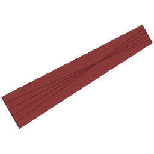
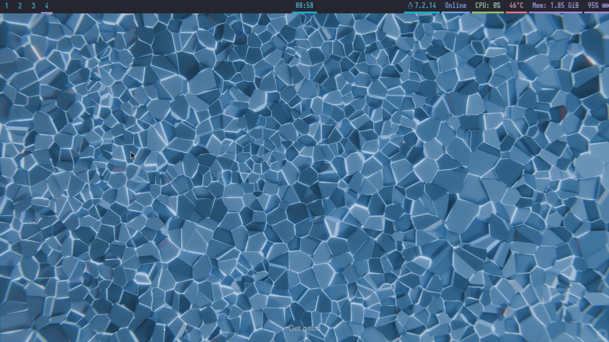
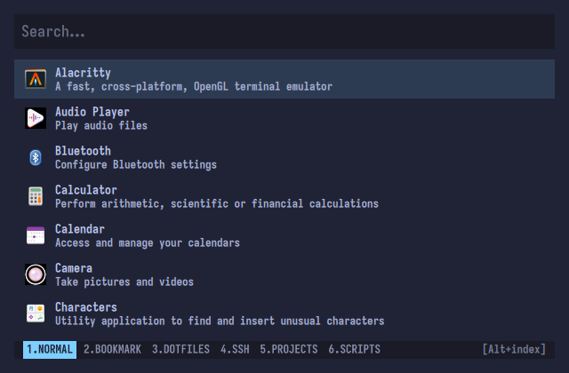
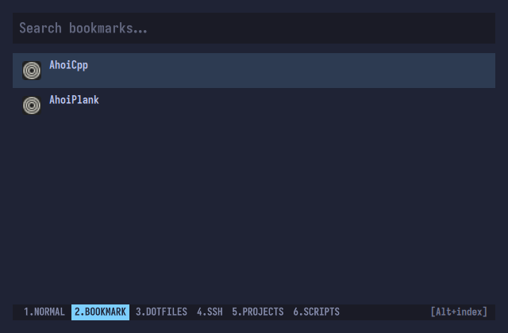
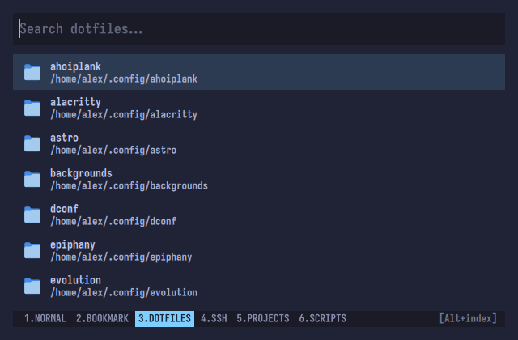
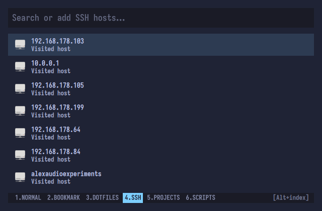
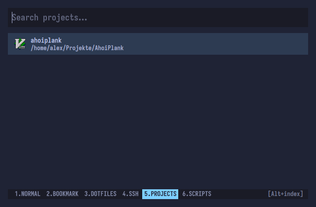
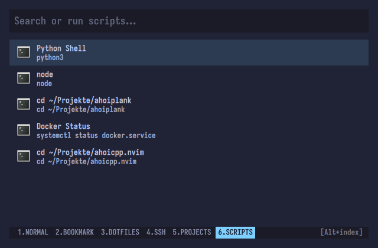

# ahoiplank 


A customizable Wayland launcher built with Qt 6 and QML that looks pretty out of the box.
It was bootstrapped with [AhoiCpp](https://github.com/martuscellifaria/ahoicpp.nvim) and looks like:



Its features are:
- fuzzy search with frecency
- normal mode for launching desktop applications
- bookmarks mode for opening bookmarks on the browser
- dotfiles mode for opening your dotfiles on your favorite terminal and terminal-based text editor
- ssh mode for starting remote sessions on a separate terminal
- projects mode for jumping to your pinned working projects
- scripts mode for running custom scripts on a terminal
- instant toggling after warmup
- vim/tmux-style status bar
- mode switcher with `Alt + index`
- for keeping the search bar editable, you can move through it char by char using `Ctrl + left/right`.

Currently tested on `sway` and `hyprland`, but should work on other Wayland compositors as well.
Distros tested were Ubuntu 26.04 and Arch Linux, both on x86_64 and aarch64.

## How to build

### Native build dependencies

For a native build, you will need:
- Qt 6.5+ (`qt6-base`, `qt6-declarative`, `qt6-wayland`, `qt6-svg`)
- LayerShellQt (`layer-shell-qt` on Arch, `liblayershellqtinterface-dev` on Ubuntu)
- CMake 3.28+, Ninja, a C++23 compiler (GCC 16+ or Clang 18+)
- Wayland and wayland-protocols, libxkbcommon

Install on Arch:

```bash
sudo pacman -S qt6-base qt6-declarative qt6-wayland qt6-svg layer-shell-qt cmake ninja gcc clang wayland wayland-protocols libxkbcommon
```

Install on Ubuntu:

```bash
sudo apt install qt6-base-dev qt6-declarative-dev qt6-wayland libqt6svg6-dev liblayershellqtinterface-dev cmake ninja-build g++-16 wayland-protocols libxkbcommon-dev
```

### Build with `build.py`

The `build.py` script drives CMake. You will get prompted to a menu, so you can set your build to release, debug, tests, add a version and so on.

```bash
python3 build.py
```

Binaries land in `build/App/ahoiplank`.

## Devcontainer

The devcontainer provides a ready-to-use environment with Qt 6, LayerShellQt, and a C++23 compiler. No host dependencies beyond Docker.
The only thing I had to do was to split the Dockerfiles in Dockerfile.ubuntu and Dockerfile.arch due to some Qt 6 compatibility issues across distros.

### Build the devcontainer and enter it

```bash
sh start_devcontainer.sh arch
```

or:

```bash
sh start_devcontainer.sh ubuntu
```

Without the flag, it defaults to Ubuntu.

This builds the `ahoiplank-dev-<distro>:<architecture>` image for your host architecture and drops you into a shell inside it. The image build takes about 2 minutes on first run and is cached afterward.

> [!NOTE]
> There is no official Arch Linux on aarch64, so if you want to build using a devcontainer, and then deploy on your Arch Linux on aarch64, you should use the Ubuntu image.

### Build ahoiplank inside the devcontainer

From inside the container:

```bash
python3 build.py
```

The instructions for native build also apply here.
The binary lands at `/workspace/build/App/ahoiplank`, which is your project directory mounted from the host.

## Running the launcher

You need to be on `Wayland`.
Then you can easily go to the directory where `ahoiplank` is compiled and run, for example:

```bash
cd build/App
./ahoiplank
```

A vertical list of applications will popup and you can fuzzy find and start it on the current workspace you are into.

## Additional modes

Besides the standard desktop launcher mode, `ahoiplank` can also be launched in the following modes:

### Bookmarks

```bash
ahoiplank --bookmarks
```

It will read from `~/.config/ahoiplank/bookmarks.json`. For example:

```json
{
  "bookmarks": [
    { 
        "name": "ahoiplank", 
        "url": "https://github.com/martuscellifaria/ahoiplank",
        "icon": "zen-browser"
    },
    { 
        "name": "AhoiCpp",
        "url": "https://github.com/martuscellifaria/ahoicpp.nvim",
        "icon": "zen-browser"
    }
  ]
}
```

Select and then it will open on your default browser.

### SSH

```bash
ahoiplank --ssh
```

It will read from `~/.ssh/known_hosts`.

And then it will start a SSH session on the terminal configured on your `config.json` file.

The SSH mode also accepts user input at the search bar if no result can be found by the fuzzy search. It then tries to start a session with the given address. `ahoiplank` is not aware of wrong typing, as it starts the session as a fire and forget process.

### Dotfiles

```bash
ahoiplank --dotfiles
```

It will read all directories inside `~/.config`. You will then be able to browse your dotfiles from in your own terminal and editor. These are set in the `config.json` file.

### Projects

```bash
ahoiplank --projects
```

It will read all pinned projects inside `~/.config/ahoiplank/projects.json`. Then can you get back to work on them.

#### Pinning projects

This is a tiny CLI feature that lets you add projects instead of manually adding entries to your `projects.json` dotfile.
You just need to go where your working project is located and then use the command:

```bash
ahoiplank --pin-project
```

After you are done with it, you can unpin it or remove manually from `projects.json`:

```bash
ahoiplank --unpin-project <Your-Project-Name>
```

You can list your projects by running

```bash
ahoiplank --list-projects
```

It will return output something like:
```
NAME            PATH
ahoiplank       /home/alex/Projekte/AhoiPlank
ahoicpp.nvim    /home/alex/Projekte/ahoicpp.nvim
```

### Scripts

The scripts mode allows the user to run and store recurrent commands. Start it with:

```bash
ahoiplank --scripts
```

If you type like `python3` at the search bar, it will then start a new instance of your configured terminal with the Python interpreter.
The command is stored in a new dotfile `.config/ahoiplank/scripts.json` which looks like:

```json
{
    "scripts": [
        {
            "icon": "utilities-terminal",
            "name": "python3",
            "persistent_terminal": true,
            "script": "python3"
        }
    ]
}
```

You can then change its name and/or if you want that the terminal instance persists when the script you ran finishes.


## Running the daemon on background

For quick startup, `ahoiplank` can run as a daemon:

```bash
ahoiplank --daemon-start
```

For stopping it:

```bash
ahoiplank --daemon-stop
```

These two commands are great for applying to startup and shutdown from your tiling window manager.

Another flags you can run are:

```bash
ahoiplank --version
```

```bash
ahoiplank --help
```

## Config Dotfiles

This repo also contains three example dotfiles. They are located at the `dotfiles/` directory, relative to the root of the repo once cloned.
The following does the trick.

```bash
cp -r dotfiles/ahoiplank ~/.config
```

## Screenshots

A few images of the six modes follow:













## Customizing

Of course, since we are on Linux and using tiling window managers, the next step is having `dotfiles`.
If you create `config.json` inside `~/.config/ahoiplank/`, you can start tinkering with it.
This is also under development, how extensible it will be. You can see a config.json example at [`config.json`](dotfiles/ahoiplank/config.json).

## Installing on your system

You have probably already compiled, so the next steps are: 

```bash
sudo cp build/App/ahoiplank /usr/local/bin/ahoiplank
```

Then you will be able to run it with `ahoiplank` from your terminal or add it to your keybindings on your window manager.

## Tests

I added some unit tests for the EntryModel class and will be adding more in the near future as the project grows.
Running is also straightforward. You can use the `build.py` script and pick an option that contains tests. It will run at the end.

That's it and thanks for using!
