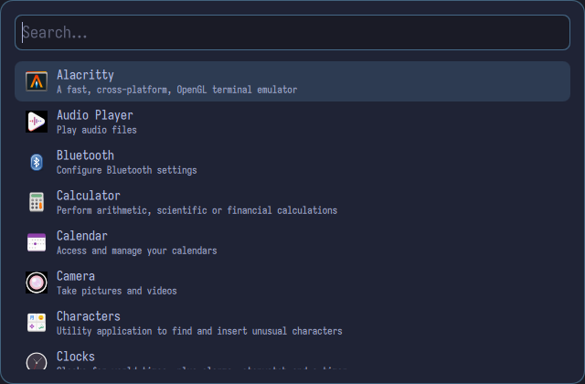
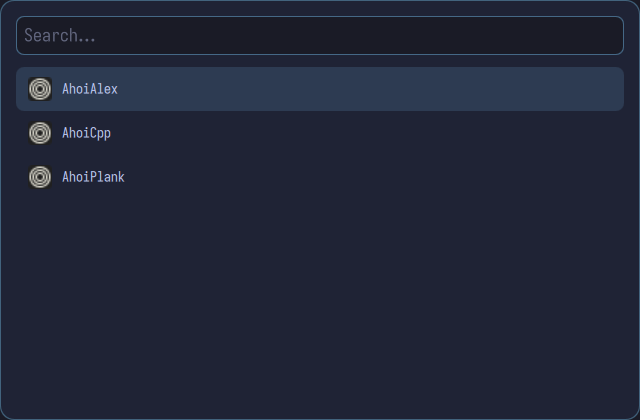
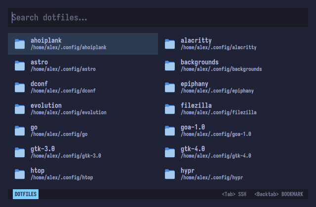

# AhoiPlank 

A minimal and customizable Wayland launcher built with Qt 6 and QML, bootstrapped with [AhoiCpp](https://github.com/martuscellifaria/ahoicpp.nvim).

Its features are:
- fuzzy search
- standard mode for launching desktop applications
- bookmark mode for opening bookmarks on the browser
- dotfiles mode for opening your dotfiles on your favorite terminal and terminal-based text editor.

`ahoiplank` has also a daemon.

Currently `AhoiPlank` looks like:


Currently tested on `sway` and `hyprland`, but should work on other Wayland wms as well.

## How to build

### Native build dependencies

For a native build, you will need:
- Qt 6.5+ (`qt6-base`, `qt6-declarative`, `qt6-wayland`, `qt6-svg`)
- LayerShellQt (`layer-shell-qt` on Arch, `liblayershellqtinterface-dev` on Ubuntu)
- CMake 3.28+, Ninja, a C++23 compiler (GCC 16+ or Clang 18+)
- Wayland and wayland-protocols, libxkbcommon

Install on Arch:

```bash
sudo pacman -S qt6-base qt6-declarative qt6-wayland qt6-svg layer-shell-qt cmake ninja gcc clang wayland wayland-protocols libxkbcommon
```

Install on Ubuntu:

```bash
sudo apt install qt6-base-dev qt6-declarative-dev qt6-wayland libqt6svg6-dev liblayershellqtinterface-dev cmake ninja-build g++-16 wayland-protocols libxkbcommon-dev
```

### Build with `build.py`

The `build.py` script drives CMake. You will get prompted to a menu, so you can set your build to release, debug, add a version and so on.

```bash
python3 build.py
```

Binaries land in `build/App/AhoiPlank`.

## Devcontainer

The devcontainer provides a ready-to-use environment with Qt 6, LayerShellQt, and a C++23 compiler. No host dependencies beyond Docker.
This is still under construction and may not work right. It compiles, but sometimes has some incompatibilities of .so files. I am working on it.

### Requirements

Docker with BuildKit (or `docker buildx`). No other host dependencies — the container provides the toolchains.

### Build the devcontainer and enter it

```bash
sh start_devcontainer.sh
```

This builds the `ahoiplank-dev` image for your host architecture and drops you into a shell inside it. The image build takes about 2 minutes on first run and is cached afterward.

### Build AhoiPlank inside the devcontainer

From inside the container:

```bash
cd /workspace
python3 build.py
```

The binary lands at `/workspace/build/App/AhoiPlank`, which is your project directory mounted from the host.

## Running the launcher

You need to be on `Wayland`.
Then you can easily go to the directory where `AhoiPlank` is compiled and run, for example:

```bash
cd build/App
./AhoiPlank
```

A vertical list of applications will popup and you can fuzzy find and start your on the current workspace you are into.

## Customizing

Of course, since we are on Linux and using tiling window managers, the next step is having `dotfiles`.
If you create `config.json` inside `~/.config/ahoiplank/`, you can start tinkering with it.
This is also under development, how extensible it will be. My first config file looks like:

```json
{
    "text_editor": "nvim",
    "text_editor_terminal": "alacritty",
    "style": {
        "screen_width": 640,
        "screen_height": 420,
        "vertical_position": "center",

        "radius_window": 14,
        "radius_item": 8,

        "font_family": "monospace",
        "font_size_search": 18,
        "font_size_title": 14,
        "font_size_comment": 11,

        "colors": {
            "bg":        "#1f2335",
            "bg_input":  "#1a1b26",
            "fg":        "#c0caf5",
            "fg_dim":    "#a9b1d6",
            "border":    "#7dcfff66",
            "selection": "#7dcfff24",
            "accent":    "#f7768e"
        }
    }
}
```

## Installing on your system

You have probably already compiled, so the next steps are: 

```bash
sudo cp build/App/AhoiPlank /usr/local/bin/ahoiplank
```

Then you will be able to run it with `ahoiplank` from your terminal or add it to your keybindings on your window manager.

## Additional modes

Besides the standard desktop launcher mode, `ahoiplank` can also be launched in the following modes:

### Bookmark

```bash
ahoiplank --bookmark
```

It will read from `~/.config/ahoiplank/bookmarks.json`. For example:

```json
{
  "bookmarks": [
    { 
        "name": "AhoiPlank", 
        "url": "https://github.com/martuscellifaria/ahoiplank",
        "icon": "zen-browser"
    },
    { 
        "name": "AhoiCpp",
        "url": "https://github.com/martuscellifaria/ahoicpp.nvim",
        "icon": "zen-browser"
    }
  ]
}
```
Then:



And then it will open on your default browser.

### Dotfiles

```bash
ahoiplank --dotfiles
```

It will read all directories inside `~/.config`. You will then be able to browse your dotfiles from `ahoiplank` in your own terminal and editor. These are set in the `config.json` file.



## Running the daemon on background

You are also able to run `ahoiplank` on the background by starting with:

```bash
ahoiplank --start-daemon
```

For stopping it:

```bash
ahoiplank --stop-daemon
```

These two commands are great for applying to startup and shutdown from your tiling window manager.

Another flags you can run are:

```bash
ahoiplank --version
```

```bash
ahoiplank --help
```

## Dotfiles

This repo also contains my two example dotfiles. They are located at the `dotfiles/` directory, relative to the root of the repo once cloned.
The following does the trick.

```bash
cp -r dotfiles/ahoiplank ~/.config
```

That's it and thanks for using!
